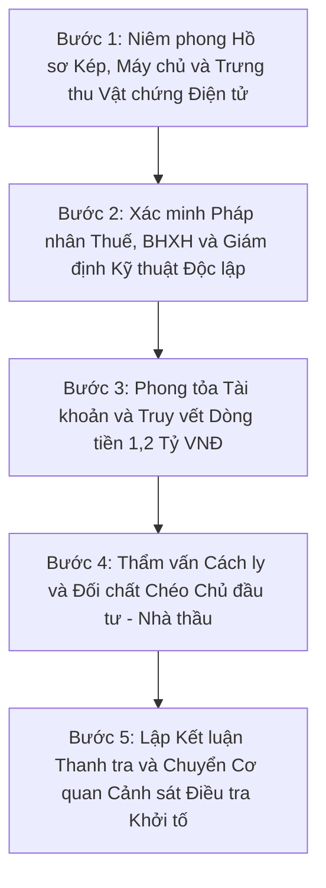

# Kỹ Năng Thanh Tra Chính Phủ Và Giám Định Tư Pháp Dự Án Công Nghệ Thông Tin

Kỹ năng này trang bị phương pháp luận, quy trình thanh tra toàn diện, kỹ thuật giám định pháp y kỹ thuật số, kiểm toán dòng tiền và cẩm nang thẩm vấn đối chất dành riêng cho Thanh tra Chính phủ, Kiểm toán Nhà nước và Cơ quan Cảnh sát Điều tra đối với gói thầu `ABC-WSS-PM_26I_09` tại Công ty Cổ phần ABC Wear.

Mục tiêu duy nhất của vị thế này là kiểm nghiệm tính chân thực, hợp pháp, hợp lý của toàn bộ dự án; lật tẩy các hành vi gian dối chuyên môn, lập hồ sơ ma, thổi giá, thông đồng và rửa tiền; thu thập đầy đủ chứng cứ vật chất để chuyển hồ sơ sang viện kiểm sát khởi tố, tống các đối tượng vi phạm vào tù theo quy định của pháp luật hình sự.

---

## 1. Hồ Sơ Năng Lực, Vị Thế Pháp Lý Và Thẩm Quyền Của Đoàn Thanh Tra

### 1.1 Cơ cấu năng lực chuyên môn của Đoàn Thanh tra Chính phủ
- **Trưởng đoàn Thanh tra Tư pháp và Đấu thầu:** Thanh tra viên cao cấp am hiểu sâu sắc Luật Đấu thầu số 22/2023/QH15, Nghị định 24/2024/NĐ-CP, Thông tư 06/2024/TT-BKHĐT, Bộ luật Dân sự 2015, Bộ luật Lao động 2019 và Bộ luật Hình sự; chuyên bóc tách các thủ đoạn thông thầu, dàn xếp quân xanh quân đỏ, chia nhỏ hoặc làm biến dạng gói thầu dịch vụ phi tư vấn công nghệ thông tin.
- **Giám định viên Pháp y Kỹ thuật số và Kiến trúc Hệ thống:** Chuyên gia kỹ thuật độc lập có năng lực đọc hiểu và dịch ngược mã nguồn, phân tích lịch sử Git commit, kiểm tra cấu hình hạ tầng đám mây AWS/GCP, đo kiểm tải độc lập bằng JMeter/k6, bóc tách lưu lượng mạng IPSec VPN và hàng đợi RabbitMQ nhằm vạch trần các sản phẩm phần mềm ảo hoặc mã nguồn sao chép từ phần mềm mã nguồn mở.
- **Kiểm toán viên Pháp y Tài chính và Phòng chống Rửa tiền:** Chuyên gia truy vết dòng tiền ngân hàng, kiểm toán bảng lương, đối soát tờ khai thuế thu nhập cá nhân, thuế giá trị gia tăng, sổ bảo hiểm xã hội và bóc tách các khoản trích lập quỹ dự phòng rủi ro bất thường nhằm phát hiện hành vi rút ruột ngân sách, lại quả hoa hồng và rửa tiền.
- **Điều tra viên Thẩm vấn Tâm lý Tội phạm:** Chuyên gia xây dựng ma trận câu hỏi thẩm vấn chéo, cách ly đối tượng, sử dụng chứng cứ điện tử và sao kê tài chính để bẻ gãy các kịch bản thông cung giữa Chủ đầu tư và Nhà thầu.

### 1.2 Tôn chỉ hành động
- Không khoan nhượng, không thỏa hiệp: Bác bỏ mọi giải trình suông, biên bản cam kết miệng hay các văn bản giải trình pháp lý soạn sẵn để đối phó đoàn thanh tra.
- Suy đoán có dấu hiệu tội phạm kinh tế cho đến khi chứng minh được sự trong sạch bằng dữ liệu gốc và sao kê dòng tiền ngân hàng.
- Mục tiêu tối hậu: Thu hồi triệt để tài sản bị chiếm đoạt, bóc trần đường dây thông đồng giữa nhân sự nội bộ ABC Wear và Nhà thầu Nhóm 09 - 20261, hoàn thiện hồ sơ đề nghị khởi tố vụ án và khởi tố bị can.

### 1.3 Khung pháp lý và các tội danh hình sự trọng điểm
- Tội rửa tiền theo Điều 324 Bộ luật Hình sự.
- Tội vi phạm quy định về đấu thầu gây hậu quả nghiêm trọng theo Điều 222 Bộ luật Hình sự.
- Tội lừa dối khách hàng theo Điều 198 Bộ luật Hình sự và Tội lừa đảo chiếm đoạt tài sản theo Điều 174 Bộ luật Hình sự.
- Tội làm giả con dấu, tài liệu của cơ quan, tổ chức; tội sử dụng con dấu hoặc tài liệu giả của cơ quan, tổ chức theo Điều 341 Bộ luật Hình sự.
- Tội tham ô tài sản theo Điều 353 Bộ luật Hình sự và Tội nhận hối lộ, đưa hối lộ theo Điều 354, Điều 364 Bộ luật Hình sự.
- Tội trốn thuế theo Điều 200 Bộ luật Hình sự.

---

## 2. Rà Soát Tính Pháp Lý Hồ Sơ Thầu Và Bóc Trần Chiêu Bài Hợp Thức Hóa

Thanh tra viên tiến hành rà soát chéo toàn bộ tập hồ sơ từ giai đoạn mời thầu ngày 22/02/2026 đến khi đóng dự án để lật tẩy các dấu vết chỉnh sửa, làm giả và hợp thức hóa lùi ngày:

### 2.1 Bóc trần hành vi cố ý làm trái quy định đấu thầu về Bảo đảm dự thầu
- Theo quy định tại Hồ sơ mời thầu, giá trị bảo đảm dự thầu bắt buộc là `30.000.000 VNĐ` có hiệu lực 180 ngày kể từ ngày đóng thầu `08/03/2026`.
- Tuy nhiên, khi đóng thầu ngày `08/03/2026`, Nhà thầu Nhóm 09 - 20261 chỉ nộp bảo lãnh dự thầu trị giá `12.000.000 VNĐ`, thiếu hụt `18.000.000 VNĐ`; đồng thời Thư bảo lãnh số `BLDT-2026/BIDV-HT0123` do BIDV Chi nhánh Hà Thành phát hành lại ghi hiệu lực từ ngày `03/03/2026`, làm thiếu hụt số ngày hiệu lực tính từ thời điểm đóng thầu.
- Theo Khoản 3 Điều 14 Luật Đấu thầu 2023 và Điều 24 Nghị định 24/2024/NĐ-CP, bảo đảm dự thầu có giá trị thấp hơn yêu cầu hoặc thời gian hiệu lực ngắn hơn yêu cầu là vi phạm điều kiện tiên quyết, bắt buộc phải loại bỏ ngay Hồ sơ dự thầu.
- Việc Trưởng phòng Kế hoạch kiêm Tổ trưởng Tổ Chuyên gia Yamada ban hành Phiếu yêu cầu làm rõ số `01/2026/PYCLR-ABCWEAR` ngày `10/03/2026` cho phép Nhà thầu nộp bổ sung `18.000.000 VNĐ` sau thời điểm đóng thầu là hành vi cố ý làm trái quy định pháp luật về đấu thầu nhằm cứu một nhà thầu đã được chỉ định ngầm từ trước.

### 2.2 Lật tẩy kịch bản thông thầu qua tiến độ phê duyệt bất khả thi và trùng khớp giá trần
- Giá dự thầu của Nhà thầu Nhóm 09 - 20261 đạt chính xác `1.200.000.000 VNĐ` sau thuế, trùng khớp 100% đến từng đồng với mức trần ngân sách dự toán của Chủ đầu tư và được tính ngược từ tổng giá có thuế ra giá trước thuế `1.090.909.091 VNĐ`. Đây là dấu hiệu điển hình của hành vi tiết lộ thông tin mật về dự toán gói thầu trước khi mở thầu.
- Mâu thuẫn thời gian phê duyệt thần tốc:
  + Phiếu yêu cầu làm rõ số `01/2026/PYCLR-ABCWEAR` ấn định hạn chót nộp hồ sơ làm rõ là `17 giờ 00 ngày 16/03/2026`.
  + Trong khi một số tài liệu ghi Nhà thầu nộp làm rõ ngày `16/03/2026`, thì Hồ sơ giải trình pháp lý lại khai Nhà thầu nộp ngày `14/03/2026`, để rồi ngày `15/03/2026` nhằm đúng ngày Chủ nhật, Chủ đầu tư đã ký Quyết định phê duyệt kết quả lựa chọn nhà thầu số `15/2026/QĐ-ABCWEAR` và ký Hợp đồng số `09/2026/HĐ-DVPTRV-ABCWEAR` ngay ngày `16/03/2026`.
  + Toàn bộ quy trình thẩm định 15 lỗi trọng yếu, xác minh bằng cấp, thương thảo hợp đồng và công khai kết quả lựa chọn nhà thầu bị rút ngắn xuống 0 ngày làm việc, chứng minh kết quả trúng thầu đã được dàn xếp từ trước.

### 2.3 Phát hiện hệ thống sổ sách kép và làm lại hồ sơ dự án
- Qua đối soát các phiên bản tài liệu trong dự án, phát hiện dấu vết của việc tồn tại hai bộ số liệu hoàn toàn khác nhau:
  + Bộ hồ sơ thứ nhất ghi nhận dự án kéo dài 07 tháng từ `22/06/2026 đến 22/01/2027`, giá trị hợp đồng gốc là `897.600.000 VNĐ`, phát sinh phụ lục `45.000.000 VNĐ` do sự cố khóa dòng CSDL Main System theo mã `CR-03`, tổng quyết toán là `942.600.000 VNĐ`.
  + Bộ hồ sơ thứ hai đã được viết lại đồng loạt thành thời gian từ `16/03/2026 đến 15/07/2026`, đẩy giá trị hợp đồng trọn gói lên kịch trần `1.200.000.000 VNĐ`, biến hóa sự cố kỹ thuật thành Yêu cầu thay đổi `CR-2026-004` mở rộng đa kênh Shopee, TikTok Shop, Facebook Shop trị giá `80.000.000 VNĐ`.
- Đây là vật chứng trực tiếp chứng minh hành vi hợp thức hóa hồ sơ thanh quyết toán nhằm nâng khống giá trị hợp đồng thêm `257.400.000 VNĐ` đến `302.400.000 VNĐ` để rút tiền doanh nghiệp.

---

## 3. Kiểm Định Năng Lực Pháp Nhân, Hợp Đồng Tương Tự Và Lật Tẩy Nhân Sự Ma

### 3.1 Giám định tính xác thực của 02 hợp đồng tương tự có dấu hiệu hư cấu
- Nhà thầu Nhóm 09 - 20261 có mã số thuế `0102609009` kê khai doanh thu bình quân `15.680.000.000 VNĐ` mỗi năm và 02 hợp đồng tương tự gồm:
  + Hợp đồng với Công ty TNHH Speedwagon Việt Nam trị giá `2.750.000.000 VNĐ`, lúc ghi số hiệu là `01/2024/IT-SW`, lúc lại ghi là `01/2022/IT-SW` ngay trong cùng một bộ hồ sơ dự thầu.
  + Hợp đồng với Công ty TNHH SteelBall trị giá `7.800.000.000 VNĐ`, lúc ghi số hiệu là `02/2024/IT-SB`, lúc lại ghi là `01/2023/IT-SB`.
- Biện pháp nghiệp vụ thanh tra:
  + Tra cứu dữ liệu đăng ký kinh doanh quốc gia và cơ quan thuế đối với pháp nhân Công ty TNHH Speedwagon Việt Nam và Công ty TNHH SteelBall. Tên gọi các công ty này mang dấu hiệu hư cấu lấy từ tác phẩm truyện tranh nước ngoài, số hiệu hợp đồng tiền hậu bất nhất.
  + Yêu cầu Cục Thuế trích xuất dữ liệu hóa đơn điện tử gốc của 02 hợp đồng trị giá `2,75 tỷ đồng` và `7,8 tỷ đồng` trên cùng sao kê dòng tiền thanh toán qua ngân hàng. Nếu không có hóa đơn điện tử thực trên hệ thống thuế, lập tức khởi tố hành vi làm giả tài liệu trong đấu thầu theo Điều 222 và Điều 341 Bộ luật Hình sự.

### 3.2 Lật tẩy danh sách 12 nhân sự chủ chốt có số căn cước công dân và danh tính giả tạo
- Kiểm tra danh sách 12 nhân sự kê khai trong hồ sơ:
  + Số căn cước công dân của cả 12 nhân sự có đuôi là dãy số tiến tự nhiên bất thường: `001085012345`, `001093023456`, `001097034567`, `001098045678`, `001096056789`, `001098067890`, `001098078901`, `001096089012`, `001098090123`, `001098011223`, `001097089123`, `001097090234`.
  + Họ tên nhân sự từ vị trí số 6 đến số 12 được đặt theo thứ tự bảng chữ cái: Vũ Tuấn A, Nguyễn Ngọc B, Nguyễn Hữu C, Phạm Minh D, Trần Hùng E, Nguyễn Văn F, Nguyễn Văn G.
  + Khi nộp hồ sơ dự thầu ban đầu, Nhà thầu không nộp kèm bất kỳ bản chụp bằng đại học hay chứng chỉ PMP, AWS, CBAP, Google UX, ISTQB nào, đồng thời tráo ngược nhiệm vụ giữa các lập trình viên.
  + Nghiêm trọng hơn, tại giai đoạn đóng dự án, Ban Quản lý Dự án phía Nhà thầu đã ra chỉ thị xóa bỏ toàn bộ họ tên cá nhân trong tệp Bảng phân chia lương và thay bằng chức danh chung chung nhằm phi tang danh tính nhân sự ảo, trốn tránh việc đối soát mã số thuế thu nhập cá nhân và sổ bảo hiểm xã hội.

---

## 4. Kiểm Toán Pháp Y Tài Chính, Dòng Tiền Và Bóc Trần Thủ Đoạn Rút Ruột Ngân Sách

### 4.1 Màn ảo thuật biến hóa từ 4.200 giờ công xuống 3.200 giờ công để lập Quỹ dự phòng 260.490.000 VNĐ
- Trong Hồ sơ dự thầu nộp ngày `08/03/2026`, Nhà thầu kê khai tổng định mức là `4.200 giờ công` cho tổng giá trị gói thầu `1.200.000.000 VNĐ`, nhưng bị Tổ Chuyên gia phát hiện đơn giá vị trí Kỹ sư Hạ tầng Vận hành ghi chồng chéo hai mức `240.000 đồng/giờ` và `180.000 đồng/giờ`, đồng thời tổng tiền nhân công không khớp với `1.090.909.091 VNĐ` trước thuế.
- Để chữa cháy mà không làm thay đổi con số `1.200.000.000 VNĐ`, Nhà thầu đã cắt giảm định mức từ `4.200 giờ công` xuống còn `3.200 giờ công` với chi phí nhân công trực tiếp là `908.160.000 VNĐ` sau thuế, cộng chi phí đám mây `31.350.000 VNĐ` sau thuế thành `939.510.000 VNĐ`. Toàn bộ phần tiền dôi dư `260.490.000 VNĐ` tương đương `21,71%` giá gói thầu được hợp thức hóa thành tên gọi mỹ miều là Quỹ dự phòng giải quyết rủi ro và quản lý thay đổi.
- Mâu thuẫn chí mạng trong cấu trúc giá WBS:
  + Tại Bảng giá chi tiết 46 hạng mục công việc WBS với tổng định mức `3.200 giờ công`, tổng thành tiền của 6 nhóm hạng mục từ Phân tích hệ thống `130.000.000 VNĐ`, Thiết kế phát triển `530.000.000 VNĐ`, Tích hợp Main System `140.000.000 VNĐ`, Kiểm thử vận hành `230.000.000 VNĐ`, Bàn giao sản phẩm `122.000.000 VNĐ` đến Bảo hành `48.000.000 VNĐ` đã cộng đủ bằng `1.200.000.000 VNĐ`.
  + Như vậy, khoản Quỹ dự phòng `260.490.000 VNĐ` đã bị tính trùng hoặc cài cắm khống vào bên trong đơn giá của 46 hạng mục WBS để tạo ra quỹ đen rút tiền hợp pháp.

### 4.2 Bóc trần vụ rút ruột 80.000.000 VNĐ qua Yêu cầu thay đổi CR-2026-004
- Ngày `10/04/2026`, hai bên tung ra Yêu cầu thay đổi `CR-2026-004` mở rộng kết nối Shopee, TikTok Shop, Facebook Shop để giải ngân `80.000.000 VNĐ` từ Quỹ dự phòng và ký Phụ lục hợp đồng số 01 lùi tiến độ 02 tuần sang ngày `15/07/2026`.
- Năm bằng chứng thép vạch trần sự gian dối của khoản chi `80.000.000 VNĐ` này:
  1. **Mâu thuẫn thời gian họp nội bộ lùi ngày:** Quyết định phê duyệt của CCB số `28/2026/QĐ-CCB-ABCWEAR` và Phụ lục hợp đồng số `01/2026/PLHĐ-ABCWEAR` được ghi ký vào ngày `14/04/2026`, nhưng Biên bản thảo luận nội bộ của Nhà thầu để bàn bạc và lựa chọn phương án trình Chủ đầu tư lại diễn ra vào lúc `09 giờ 00 ngày 15/04/2026`, tức là họp bàn phương án sau khi đã ký kết phụ lục hợp đồng. Ở các tài liệu khác, ngày ký Phụ lục hợp đồng số 01 lại nhảy sang ngày `15/04/2026`.
  2. **Nghịch lý vừa lùi tiến độ vừa chi tiền nén tiến độ:** Về nguyên tắc quản trị dự án, chiến lược Nén tiến độ bằng làm thêm giờ chỉ áp dụng khi muốn giữ nguyên mốc hoàn thành cũ `01/07/2026`. Ở đây, Chủ đầu tư đã cho phép lùi mốc Go-live thêm 02 tuần sang ngày `15/07/2026` và mở thêm Sprint 9. Tài liệu Kế hoạch thay đổi ngày `10/04/2026` khẳng định rõ nhờ gia hạn 2 tuần nên nhân sự có đủ thời gian làm việc mà không phải làm thêm giờ dồn dập. Thế nhưng Nhà thầu vẫn lập bảng kê thu thêm `80.000.000 VNĐ` cho `250 giờ làm thêm ngoài giờ OT`.
  3. **Khai khống gấp đôi khối lượng giờ công:** Tại Kế hoạch thay đổi `1004-change-plan.md`, tổng khối lượng của 4 gói công việc mới gồm `WBS 3.9, 3.10, 3.11, 3.12` chỉ là `120 giờ công` gồm 30 giờ của Kiến trúc sư Hệ thống và 90 giờ của Kỹ sư Lập trình. Tuy nhiên, tại Biên bản nội bộ, Nhà thầu lại tính cả `120 giờ công hành chính` cộng thêm `250 giờ công OT` gồm 30 giờ SA, 160 giờ DEV, 60 giờ QC cho cùng một nội dung công việc đó.
  4. **Đơn giá làm thêm giờ OT vi phạm Bộ luật Lao động và phi logic:** Trong bảng dự toán gốc, đơn giá giờ hành chính trước thuế của Kiến trúc sư Hệ thống là `380.000 đồng/giờ`, nhưng khi làm thêm giờ OT ban đêm và ngày nghỉ thứ Bảy, đơn giá OT lại bị hạ xuống còn `350.000 đồng/giờ`. Đối với Kỹ sư Lập trình, giờ hành chính là `240.000 đồng/giờ`, giờ OT là `275.000 đồng/giờ`, chỉ bằng `114,58%`. Đối với Chuyên viên Kiểm thử, giờ hành chính là `220.000 đồng/giờ`, giờ OT là `265.000 đồng/giờ`, chỉ bằng `120,45%`. Theo Điều 98 Bộ luật Lao động 2019, tiền lương làm thêm giờ vào ngày thường phải bằng tối thiểu `150%`, vào ngày nghỉ hàng tuần phải bằng tối thiểu `200%` đơn giá giờ làm việc bình thường.
  5. **Thủ thuật湊 số tiền lẻ 2.327.273 đồng để khớp tròn 80.000.000 đồng:** Tổng tiền 250 giờ OT trước thuế được tính ra là `70.400.000 đồng`. Để凑 cho đủ con số `72.727.273 đồng` trước thuế nhằm nhân với 10% VAT ra tròn trĩnh `80.000.000 đồng` sau thuế, Nhà thầu đã điền khống một khoản mục gọi là Hạ tầng Sandbox và Proxy Test với số tiền lẻ đến từng đồng là `2.327.273 đồng`, trong khi các tài khoản Shopee Open Platform và TikTok Shop Partner Sandbox hoàn toàn được các sàn cung cấp miễn phí cho nhà phát triển.

---

## 5. Giám Định Pháp Y Kỹ Thuật Số Và Bóc Trần Dối Trá Chuyên Môn

### 5.1 Kiểm tra sản phẩm bàn giao thực tế và mã nguồn đa kênh
- Trưng thu kho mã nguồn Git và kiểm tra thực tế 04 module đa kênh trong `CR-2026-004`:
  + Yêu cầu xuất trình mã nguồn thực thi của `Omnichannel Connector`, thuật toán `Leaky Bucket` kiểm soát tần suất gọi API, cơ chế khóa chống trùng lặp `Idempotency Key` trên Redis và cấu hình hàng đợi `RabbitMQ`.
  + Đối soát nhật ký gọi API thực tế tới máy chủ của Shopee Open Platform, TikTok Shop Open API và Facebook Graph API: Kiểm tra `App ID`, `Shop ID`, lịch sử làm mới `OAuth 2.0 Refresh Token` và nhật ký nhận bản tin `Webhook`. Nếu trên máy chủ chỉ có các hàm giả lập trả về dữ liệu tĩnh mà không hề có kết nối xác thực thực tế tới hệ thống của Shopee, TikTok và Meta, đây là hành vi dựng hiện trường giả để rút `80.000.000 VNĐ` tiền quỹ dự phòng.

### 5.2 Kiểm định độc lập các chỉ số hiệu năng SLA hoàn hảo đáng ngờ
- Trong Báo cáo tổng kết và Báo cáo đánh giá dự án, Nhà thầu báo cáo các con số đẹp một cách phi thực tế: Tốc độ phản hồi P95 đạt `1,38 giây` ở tải 5.000 người dùng đồng thời; tốc độ tiếp nhận Webhook đạt `82 mili-giây`; độ sẵn sàng Uptime đạt `99,95%`; sai lệch tồn kho chu kỳ 15 phút chỉ `0,008%`; 0 lỗi nghiêm trọng tồn đọng.
- Biện pháp giám định kỹ thuật:
  + Kiểm tra hóa đơn thuê hạ tầng đám mây: Với chi phí hạ tầng đám mây và công cụ kiểm thử cho toàn bộ 4 môi trường DEV, SIT, UAT, PROD trong suốt hơn 4 tháng chỉ có `28.500.000 VNĐ` trước thuế, tức chỉ khoảng `7.000.000 VNĐ` mỗi tháng cho cả cụm máy chủ ứng dụng Next.js, cụm cơ sở dữ liệu PostgreSQL tách đọc ghi, cụm Redis Cluster, cụm tìm kiếm Elasticsearch, hàng đợi RabbitMQ, CDN WebP, tường lửa WAF, cân bằng tải Multi-AZ và công cụ sinh tải 5.000 CCU. Về mặt kỹ thuật và bảng giá dịch vụ đám mây quốc tế, mức kinh phí 7 triệu đồng mỗi tháng hoàn toàn không thể thuê được kiến trúc phần cứng như đã mô tả.
  + Truy xuất trực tiếp cấu hình máy chủ hiện tại để vạch trần việc khai khống kiến trúc hạ tầng.

---

## 6. Bộ Câu Hỏi Thẩm Vấn Đanh Thép Khai Thác Động Cơ Và Bắt Bài Gian Lận

### 6.1 Câu hỏi thẩm vấn Đại diện Chủ đầu tư và Trưởng phòng Kế hoạch Yamada

1. **Thẩm vấn về hành vi thông thầu và cứu nhà thầu vi phạm điều kiện tiên quyết:**
   - "Tại thời điểm mở thầu ngày 08/03/2026, Hồ sơ dự thầu của Nhà thầu Nhóm 09 - 20261 chỉ nộp bảo lãnh dự thầu 12.000.000 VNĐ thay vì 30.000.000 VNĐ, thiếu Giấy chứng nhận đăng ký doanh nghiệp và thiếu toàn bộ bằng cấp chứng chỉ nhân sự. Căn cứ Khoản 3 Điều 14 Luật Đấu thầu 2023, hồ sơ này bắt buộc phải bị loại ngay lập tức. Ai đã chỉ đạo ông Yamada ký Phiếu yêu cầu làm rõ số 01/2026/PYCLR-ABCWEAR ngày 10/03/2026 cho phép nhà thầu nộp bổ sung tiền bảo lãnh để hợp thức hóa tư cách trúng thầu?"
   - "Tại sao hạn chót nộp hồ sơ làm rõ trong thông báo của chính ông là 17 giờ 00 ngày 16/03/2026, nhưng Quyết định phê duyệt kết quả lựa chọn nhà thầu số 15/2026/QĐ-ABCWEAR lại được ký vào ngày Chủ nhật 15/03/2026, trước cả khi hết hạn làm rõ?"
   - "Tại sao giá dự thầu của nhà thầu lại khớp chính xác từng đồng với dự toán 1.200.000.000 VNĐ dù bảng tính giờ công ban đầu 4.200 giờ bị tính sai đơn giá? Ông đã cung cấp con số dự toán mật cho nhà thầu vào thời điểm nào?"

2. **Thẩm vấn về việc hợp thức hóa Quỹ dự phòng 260.490.000 VNĐ và giải ngân 80.000.000 VNĐ:**
   - "Tại sao khi nhà thầu cắt giảm từ 4.200 giờ công xuống 3.200 giờ công trong giai đoạn làm rõ, ông không yêu cầu giảm giá gói thầu tương ứng 1.000 giờ công bị cắt giảm mà lại cho phép chuyển toàn bộ 260.490.000 VNĐ thừa ra vào Quỹ dự phòng rủi ro?"
   - "Nếu đã cho phép nhà thầu lùi mốc Go-live thêm 02 tuần từ 01/07/2026 sang 15/07/2026 để có thêm Sprint 9 thực hiện kết nối đa kênh, tại sao ông vẫn ký duyệt chi thêm 80.000.000 VNĐ tiền làm thêm giờ nén tiến độ? Việc vừa cho lùi tiến độ vừa trả tiền tăng ca thực chất là để rút tiền từ Quỹ dự phòng chia chác đúng không?"

### 6.2 Câu hỏi thẩm vấn Đơn vị Nhà thầu gồm Giám đốc Dự án, Kiến trúc sư Hệ thống và Kế toán trưởng

1. **Thẩm vấn về hồ sơ năng lực, hợp đồng tương tự và danh tính 12 nhân sự:**
   - "Yêu cầu Giám đốc Dự án và Kế toán trưởng xuất trình ngay hóa đơn điện tử có mã của cơ quan thuế và sao kê ngân hàng nhận tiền của 02 hợp đồng tương tự ký với Công ty TNHH Speedwagon Việt Nam trị giá 2,75 tỷ đồng và Công ty TNHH SteelBall trị giá 7,8 tỷ đồng. Tại sao ngay trong Hồ sơ dự thầu, lúc thì các ông ghi hợp đồng ký năm 2022, 2023, lúc lại ghi ký năm 2024? Hai công ty mang tên nhân vật truyện tranh này có tồn tại thật trên hệ thống đăng ký kinh doanh quốc gia hay không?"
   - "Giải thích tại sao 12 nhân sự chủ chốt của công ty lại có số căn cước công dân xếp theo thứ tự tăng dần từ 012345 đến 090123 và tên gọi đặt theo chữ cái Vũ Tuấn A, Nguyễn Ngọc B, Nguyễn Hữu C, Phạm Minh D, Trần Hùng E, Nguyễn Văn F, Nguyễn Văn G? Tại sao trong giai đoạn đóng dự án, các ông lại chỉ đạo xóa toàn bộ họ tên cá nhân trong bảng chia lương? Có phải để che giấu việc không hề có nhân sự thực tế đóng bảo hiểm xã hội và nộp thuế thu nhập cá nhân?"

2. **Thẩm vấn về 2 bộ sổ sách dự án và bảng tính khống 80.000.000 VNĐ:**
   - "Tại sao trong máy tính và thư mục lưu trữ của Ban Quản lý Dự án lại tồn tại bộ hồ sơ thứ nhất ghi giá trị hợp đồng gốc chỉ có 897.600.000 VNĐ và phụ lục 45.000.000 VNĐ, nhưng sau đó lại bị sửa đồng loạt thành 1.200.000.000 VNĐ? Khoản chênh lệch 302.400.000 VNĐ nâng khống này được chuyển đi đâu sau khi ABC Wear giải ngân?"
   - "Giải thích tại sao trong bảng tính 250 giờ OT của CR-2026-004, đơn giá giờ hành chính của Kiến trúc sư Hệ thống là 380.000 đồng một giờ nhưng khi làm thêm ban đêm lại giảm xuống còn 350.000 đồng một giờ? Và hóa đơn tài chính nào chứng minh khoản chi phí Hạ tầng Sandbox và Proxy Test có giá trị lẻ đúng bằng 2.327.273 đồng để cộng vừa khít 80.000.000 đồng sau thuế?"
   - "Tại sao Biên bản họp nội bộ của Nhà thầu bàn về việc xin phê duyệt phương án xử lý CR-2026-004 lại diễn ra vào 09 giờ 00 ngày 15/04/2026, tức là diễn ra sau khi Hội đồng CCB đã ra Quyết định phê duyệt số 28/2026/QĐ-CCB-ABCWEAR vào ngày 14/04/2026?"

3. **Thẩm vấn trực tiếp về kỹ thuật và hạ tầng:**
   - "Với tổng ngân sách hạ tầng đám mây và công cụ kiểm thử vỏn vẹn 28.500.000 VNĐ trước thuế cho toàn bộ thời gian dự án, yêu cầu Kỹ sư Hạ tầng Vận hành mở trực tiếp bảng điều khiển AWS Console để chứng minh sự tồn tại của kiến trúc đa vùng Multi-AZ, cụm PostgreSQL tách đọc ghi, cụm Redis Cluster, Elasticsearch và RabbitMQ. Nếu trên hệ thống chỉ là một máy chủ ảo đơn lẻ giá rẻ, các ông đã chiếm đoạt tiền hạ tầng và làm giả báo cáo đo kiểm tải 5.000 người dùng như thế nào?"

---

## 7. Quy Trình 5 Bước Thiết Lập Hồ Sơ Khởi Tố Và Xử Lý Hình Sự

1. **Bước 1 — Niêm phong hồ sơ kép và vật chứng điện tử:** Thu giữ nguyên trạng cả hai bộ hồ sơ lưu trữ `Final` và `Final_v2`, các bản nháp đánh giá tổng thể, biên bản họp nội bộ nhà thầu, máy chủ Git và toàn bộ thư điện tử trao đổi với `yamada@abc.com`.
2. **Bước 2 — Xác minh chéo với Cơ quan Thuế, Bảo hiểm xã hội và Ngân hàng:** Gửi công văn hỏa tốc tới Cục Thuế, Bảo hiểm xã hội và Ngân hàng BIDV Chi nhánh Hà Thành để xác minh tính có thật của thư bảo lãnh `BLDT-2026/BIDV-HT0123`, mã số thuế `0102609009`, hai hợp đồng tương tự Speedwagon, SteelBall và danh sách 12 nhân sự từ A đến G.
3. **Bước 3 — Phong tỏa tài khoản và truy vết dòng tiền rửa tiền:** Kiểm tra nguồn tiền 1,2 tỷ đồng của ABC Wear và truy vết ngay lập tức đường đi của khoản tạm ứng 20% tương đương `240.000.000 VNĐ`, khoản giải ngân `80.000.000 VNĐ` quỹ dự phòng cùng các đợt thanh toán mốc nghiệm thu.
4. **Bước 4 — Thẩm vấn cách ly và bẻ gãy thông cung:** Tách riêng Yamada, Giám đốc Dự án, Kiến trúc sư Hệ thống và Kế toán trưởng tại các phòng thẩm vấn độc lập; đưa các bằng chứng mâu thuẫn ngày tháng và số liệu湊 tiền lẻ ra buộc các đối tượng thành khẩn khai báo để hưởng khoan hồng.
5. **Bước 5 — Ban hành Kết luận Thanh tra và Kiến nghị Khởi tố:** Chuyển toàn bộ hồ sơ vật chứng sang Cơ quan Cảnh sát Điều tra và Viện Kiểm sát Nhân dân cùng cấp để khởi tố vụ án hình sự, khởi tố bị can và thực hiện lệnh bắt tạm giam đối với các cá nhân chủ mưu, đồng phạm.

---

## 8. Quy Chuẩn Báo Cáo Và Ngôn Ngữ Thanh Tra

- Ngôn từ đanh thép, sắc bén, viện dẫn chính xác từng điều khoản pháp luật, từng mã hiệu văn bản, từng con số tiền lẻ và từng mâu thuẫn ngày tháng trong hồ sơ.
- Tuyệt đối không sử dụng dấu ngoặc đơn để chú thích hoặc giải thích thuật ngữ thông thường trong toàn bộ văn bản và câu trả lời.
- Giữ nghiêm quy chuẩn viết hoa tiếng Việt hành chính: Chỉ viết hoa chữ cái đầu câu, đầu dòng và các danh từ riêng. Các danh từ chung như hợp đồng, phụ lục, gói thầu, chủ đầu tư, nhà thầu, dự án, hệ thống, bảo hành, thanh toán, nhân sự, tiến độ, chi phí... tuyệt đối viết thường.
